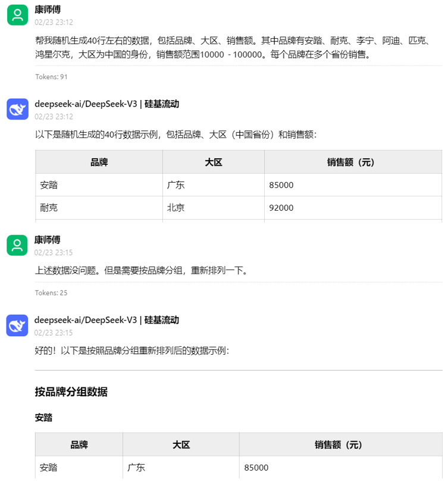
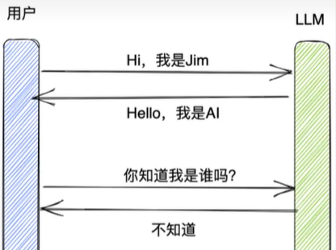
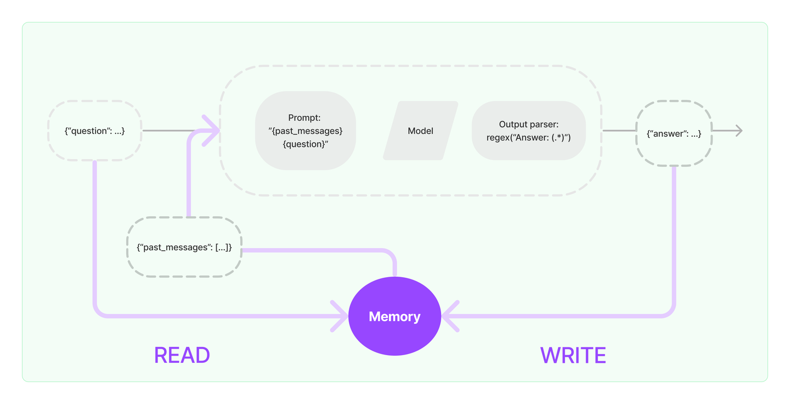
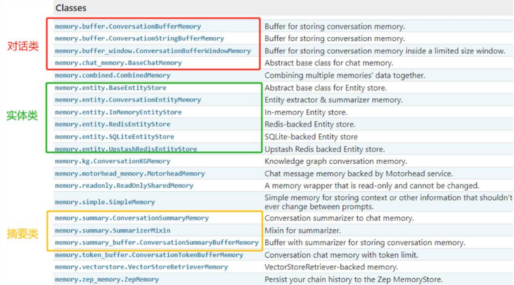
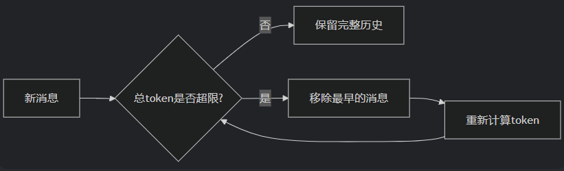
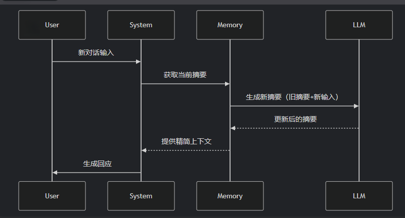
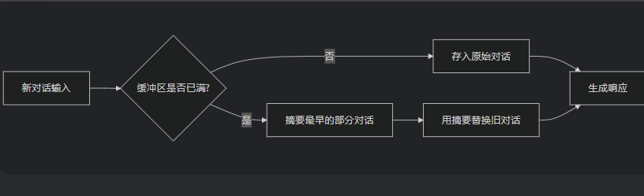
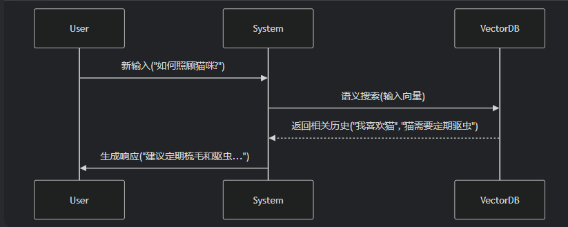

# 第04章：LangChain使用之Memory

讲师：尚硅谷-宋红康

官网：尚硅谷

## 1、Memory概述

### 1.1 为什么需要Memory

大多数的大模型应用程序都会有一个会话接口，允许我们进行多轮的对话，并有一定的上下文记忆能力。



但实际上，模型本身是**不会记忆**任何上下文的，只能依靠用户本身的输入去产生输出。



**如何实现记忆功能呢？**

实现这个记忆功能，就需要**额外的模块**去保存我们和模型对话的上下文信息，然后在下一次请求时，把所有的历史信息都输入给模型，让模型输出最终结果。

而在 LangChain 中，提供这个功能的模块就称为 **Memory(记忆)**，用于存储用户和模型交互的历史信息。

### 1.2 什么是Memory

**Memory，是LangChain中用于多轮对话中保存和管理上下文信息（比如文本、图像、音频等）的组件**。它让应用能够记住用户之前说了什么，从而实现对话的**上下文感知能力**，为构建真正智能和上下文感知的链式对话系统提供了基础。

### 1.3 Memory的设计理念



1. 输入问题：({"question": ...})

2. 读取历史消息：从Memory中READ历史消息（{"past_messages": [...]}）

3. 构建提示（Prompt)：读取到的历史消息和当前问题会被合并，构建一个新的Prompt

4. 模型处理：构建好的提示会被传递给语言模型进行处理。语言模型根据提示生成一个输出。

5. 解析输出：输出解析器通过正则表达式 regex("Answer: (.*)")来解析，返回一个回答（{"answer": ...}）给用户

6. 得到回复并写入Memory：新生成的回答会与当前的问题一起写入Memory，更新对话历史。

Memory会存储最新的对话内容，为后续的对话提供上下文支持。

**问题：**一个链如果接入了**Memory** 模块，其会与Memory模块交互几次呢？

链内部会与**Memory** 模块进行两次交互：读取和写入：

1、收到用户输入时，从记忆组件中查询相关历史信息，拼接历史信息和用户的输入到提示词中传给LLM。

2、返回响应之前，自动把LLM返回的内容写入到记忆组件，用于下次查询。

### 1.4 不使用Memory模块，如何拥有记忆？

不借助LangChain情况下，我们如何实现大模型的记忆能力？

思考：通过**messages** 变量，不断地将历史的对话信息追加到对话列表中，以此让大模型具备上下文记忆能力。

```
import os
import dotenv
from langchain_openai import ChatOpenAI

dotenv.load_dotenv()

os.environ['OPENAI_API_KEY'] = os.getenv("OPENAI_API_KEY1")
os.environ['OPENAI_BASE_URL'] = os.getenv("OPENAI_BASE_URL")

# 创建大模型实例
llm = ChatOpenAI(model="gpt-4o-mini")
```

```
from langchain.prompts import ChatPromptTemplate
from langchain_openai import ChatOpenAI
from langchain_core.messages import SystemMessage, HumanMessage, AIMessage

llm = ChatOpenAI(model="gpt-4o-mini")

def chat_with_model(question):
    # 步骤一：初始化消息
    chat_prompt_template = ChatPromptTemplate.from_messages([
        ("system","你是一位人工智能小助手"),
        ("human","{question}")
    ])

    # 步骤二：定义一个循环体：
    while True:
        # 步骤三：调用模型
        chain = chat_prompt_template | llm

        response = chain.invoke({"question": question})

        # 步骤四：获取模型回答
        print(f"模型回答: {response.content}")

        # 询问用户是否还有其他问题
        user_input = input("您还有其他问题想问嘛？(输入'退出'结束对话)")

        # 设置结束循环的条件
        if(user_input == "退出"):
            break

        # 步骤五：记录用户回答
        chat_prompt_template.messages.append(AIMessage(content=response.content))
        chat_prompt_template.messages.append(HumanMessage(content=user_input))

chat_with_model("你好")
```

> 模型回答: 请问有什么我可以帮助您的？
>
> 模型回答: 李白是唐代著名的诗人，他的名字中有“白”字，但并不代表他肤色就特别白。实际上，李白在中国文学史上以其豪放不拘的个性和高超的诗才闻名，更多的是因为他的诗歌成就而受到赞誉。如果您对李白或其作品有兴趣，可以问我更多！
>
> 模型回答: 您刚才问了关于李白的问题，提到“李白是不是很白”，我回答了李白是唐代著名的诗人，他的名字中的“白”并不代表肤色。您可以继续提问或者讨论其他话题！
>
> 模型回答: 李白有许多著名的诗篇，以下是一些他的代表作品：
>
> 1.《将进酒》- 这首诗表达了李白豪放的个性和对人生短暂的思考。
>
> 2.《静夜思》- 描述了他在静夜中思念故乡的情感，是非常经典的诗篇。
>
> 3.《庐山谣》- 赞美庐山的壮美景色，表现了李白对自然的热爱。
>
> 4.《月下独酌》- 这首诗表达了他在月光下独自饮酒的孤独与洒脱。
>
> 5.《早发白帝城》- 描绘了他清晨离开白帝城的美丽景色。
>
> 如果您想了解更多具体的诗歌或其背后的故事，欢迎继续提问！

相应几次的问题分别是：

```
> 你好
> 李白很白吗？
> 刚才我聊的诗人是谁？
> 他有哪些著名的诗篇
> 退出
```

这种形式是最简单的一种让大模型具备上下文知识的存储方式，任何记忆的基础都是所有聊天交互的历史记录。即使这些不全部直接使用，也需要以某种形式存储。

## 2、基础Memory模块的使用

### 2.1 Memory模块的设计思路

**如何设计Memory模块？**

层次1(最直接的方式)：保留一个聊天消息列表

层次2(简单的新思路)：只返回最近交互的k条消息

层次3(稍微复杂一点)：返回过去k条消息的简洁摘要

层次4(更复杂)：从存储的消息中提取实体，并且仅返回有关当前运行中引用的实体的信息

**LangChain的设计：**

针对上述情况，LangChain构建了一些可以直接使用的**Memory** 工具，用于存储聊天消息的一系列集成。



### 2.2 ChatMessageHistory(基础)

ChatMessageHistory是一个用于**存储和管理对话消息**的基础类，它直接操作消息对象（如

HumanMessage, AIMessage 等），是其它记忆组件的底层存储工具。

在API文档中，ChatMessageHistory 还有一个别名类：InMemoryChatMessageHistory；导包时，需使用：from langchain.memory import ChatMessageHistory

**特点**：

- 纯粹是消息对象的“**存储器**”，与记忆策略（如缓冲、窗口、摘要等）无关。

- 不涉及消息的格式化（如转成文本字符串）

#### 场景1：记忆存储

ChatMessageHistory是用于管理和存储对话历史的具体实现。

```
#1.导入相关包
from langchain.memory import ChatMessageHistory

#2.实例化ChatMessageHistory对象
history = ChatMessageHistory()

# 3.添加UserMessage
history.add_user_message("hi!")

# 4.添加AIMessage
history.add_ai_message("whats up?")

# 5.返回存储的所有消息列表
print(history.messages)
```

```
[HumanMessage(content="hi!", additional_kwargs={}, response_metadata={}),
AIMessage(content="whats up?", additional_kwargs={}, response_metadata={})]
```

#### 场景2：对接LLM

```
from langchain.memory import ChatMessageHistory

history = ChatMessageHistory()

history.add_ai_message("我是一个无所不能的小智")
history.add_user_message("你好，我叫小明，请介绍一下你自己")
history.add_user_message("我是谁呢？")

print(history.messages)  #返回List[BaseMessage]类型
```

```
[AIMessage(content="我是一个无所不能的小智', additional_kwargs={}, response_metadata=
{}), HumanMessage(content="你好，我叫小明，请介绍一下你自己', additional_kwargs={},
response_metadata={}), HumanMessage(content="我是谁呢？', additional_kwargs={},
response_metadata={})]
```

继续

```
# 创建LLM
llm = ChatOpenAI(model_name='gpt-4o-mini')

llm.invoke(history.messages)
```

```
AIMessage(content="你好，小明！我是一个人工智能助手，旨在为你提供信息、回答问题，以及
帮助你解决各种问题。你可以问我任何事情，无论是关于知识、学习还是生活中的实际问题，我都
会尽力帮助你！你今天想聊些什么呢？', additional_kwargs={"refusal": None},
response_metadata={"token_usage": {"completion_tokens": 59, "prompt_tokens": 36,
"total_tokens": 95, "completion_tokens_details": {"accepted_prediction_tokens": 0,
"audio_tokens": 0, "reasoning_tokens": 0, "rejected_prediction_tokens": 0},
"prompt_tokens_details": {"audio_tokens": 0, "cached_tokens": 0}}, "model_name": "gpt-4o-
mini-2024-07-18", "system_fingerprint": "fp_efad92c60b", "id": "chatcmpl-
BpnIMSTuLSRcmpJJlIfVmPWB8hGhW", "service_tier": None, "finish_reason": "stop",
"logprobs": None}, id="run--cd9b5546-0799-47d2-9c0f-ac35aa78e9b1-0", usage_metadata=
{"input_tokens": 36, "output_tokens": 59, "total_tokens": 95, "input_token_details": {"audio": 0,
"cache_read": 0}, "output_token_details": {"audio": 0, "reasoning": 0}})
```

### 2.3 ConversationBufferMemory

ConversationBufferMemory是一个基础的**对话记忆（Memory）组件**，专门用于按**原始顺序存储**完整的对话历史。

**适用场景**：对话轮次较少、依赖完整上下文的场景（如简单的聊天机器）

**特点**：

- 完整存储对话历史

- **简单**、**无裁剪**、**无压缩**

- 与 Chains/Models 无缝集成

- 支持两种返回格式（通过 **return_messages** 参数控制输出格式）

**return_messages=True** 返回消息对象列表（**List[BaseMessage]**

**return_messages=False（默认）** 返回拼接的**纯文本字符串**

#### 场景1：入门使用

举例1：

```
# 1.导入相关包
from langchain.memory import ConversationBufferMemory

# 2.实例化ConversationBufferMemory对象
memory = ConversationBufferMemory()
# 3.保存消息到内存中
memory.save_context(inputs = {"input": "你好，我是人类"}, outputs = {"output": "你好，我是AI助手"})
memory.save_context(inputs = {"input": "很开心认识你"}, outputs = {"output": "我也是"})

# 4.读取内存中消息（返回消息内容的纯文本）
print(memory.load_memory_variables({}))
```

```
{"history": "Human: 你好，我是人类\nAI: 你好，我是AI助手\nHuman: 很开心认识你\nAI: 我也
是'}
```

注意：

- 不管inputs、outputs的key用什么名字，都认为inputs的key是human，outputs的key是AI。

- 打印的结果的json数据的key，默认是“history”。可以通过ConversationBufferMemory的**memory_key** 属性修改。

举例2：

```
# 1.导入相关包
from langchain.memory import ConversationBufferMemory

# 2.实例化ConversationBufferMemory对象
memory = ConversationBufferMemory(return_messages=True)

# 3.保存消息到内存中
memory.save_context({"input": "hi"}, {"output": "whats up"})

# 4.读取内存中消息（返回消息）
print(memory.load_memory_variables({}))

# 5.读取内存中消息( 访问原始消息列表)
print(memory.chat_memory.messages)
```

```
{"history": [HumanMessage(content="hi", additional_kwargs={}, response_metadata={}),
AIMessage(content="whats up", additional_kwargs={}, response_metadata={})]}
[HumanMessage(content="hi", additional_kwargs={}, response_metadata={}),
AIMessage(content="whats up", additional_kwargs={}, response_metadata={})]
```

#### 场景2：结合chain

举例1：使用PromptTemplate

```
from langchain_openai import OpenAI
from langchain.memory import ConversationBufferMemory
from langchain.chains.llm import LLMChain
from langchain_core.prompts import PromptTemplate

# 初始化大模型
llm = OpenAI(model="gpt-4o-mini", temperature=0)

# 创建提示
# 有两个输入键：实际输入与来自记忆类的输入 需确保PromptTemplate和ConversationBufferMemory中的键匹配
template = """你可以与人类对话。

当前对话: {history}

人类问题: {question}

回复:
"""

prompt = PromptTemplate.from_template(template)

# 创建ConversationBufferMemory
memory = ConversationBufferMemory()

# 初始化链
chain = LLMChain(llm=llm, prompt=prompt, memory=memory)

# 提问
res1 = chain.invoke({"question": "我的名字叫Tom"})
print(res1)
```

```
{"question": '我的名字叫Tom", "history": '', "text": '你好，Tom！很高兴认识你。你今天过得怎么
样？有什么我可以帮助你的吗？'}
```

继续：

```
res = chain.invoke({"question": "我的名字是什么?"})
print(res)
```

> {"question": '我的名字是什么?', "history": "Human: 我的名字叫Tom\nAI: 你好，Tom！很高兴认识你。你今天过得怎么样？有什么我可以帮助你的吗？', "text": '你的名字是Tom。你今天过得怎么样？有什么我可以帮助你的吗？'}

举例2：可以通过memory_key修改memory数据的变量名

```
from langchain_openai import OpenAI
from langchain.memory import ConversationBufferMemory
from langchain.chains.llm import LLMChain
from langchain_core.prompts import PromptTemplate

# 初始化大模型
llm = OpenAI(model="gpt-4o-mini", temperature=0)

# 创建提示
# 有两个输入键：实际输入与来自记忆类的输入 需确保PromptTemplate和ConversationBufferMemory中的键匹配
template = """你可以与人类对话。

当前对话: {chat_history}

人类问题: {question}

回复:
"""

prompt = PromptTemplate.from_template(template)

# 创建ConversationBufferMemory
memory = ConversationBufferMemory(memory_key="chat_history")

# 初始化链
chain = LLMChain(llm=llm, prompt=prompt, memory=memory)

# 提问
res1 = chain.invoke({"question": "我的名字叫Tom"})
print(str(res1) + "\n")

res = chain.invoke({"question": "我的名字是什么?"})
print(res)
```

```
{"question": '我的名字叫Tom", "chat_history": '', "text": '你好，Tom！很高兴认识你。有什么我可
以帮助你的吗？'}
{"question": '我的名字是什么?', "chat_history": "Human: 我的名字叫Tom\nAI: 你好，Tom！很
高兴认识你。有什么我可以帮助你的吗？', "text": '你的名字是Tom。很高兴再次见到你！有什么我
可以帮助你的吗？'}
```

说明：创建带Memory功能的Chain，并不能使用统一的LCEL语法。同样地，**LLMChain** 也不能使用管道运算符接**StrOutputParser**。这些设计上的问题，个人推测也是目前Memory模块还是Beta版本的原因之一吧。

举例3：使用ChatPromptTemplate 和 return_messages

```
# 1.导入相关包
from langchain_core.messages import SystemMessage
from langchain.chains.llm import LLMChain
from langchain.memory import ConversationBufferMemory
from langchain_core.prompts import MessagesPlaceholder,ChatPromptTemplate,HumanMessagePromptTemplate
from langchain_openai import ChatOpenAI

# 2.创建LLM
llm = ChatOpenAI(model_name='gpt-4o-mini')

# 3.创建Prompt
prompt = ChatPromptTemplate.from_messages([
    ("system","你是一个与人类对话的机器人。"),
    MessagesPlaceholder(variable_name='history'),
    ("human","问题：{question}")
])

# 4.创建Memory
memory = ConversationBufferMemory(return_messages=True)
# 5.创建LLMChain
llm_chain = LLMChain(prompt=prompt,llm=llm, memory=memory)

# 6.调用LLMChain
res1 = llm_chain.invoke({"question": "中国首都在哪里？"})
print(res1,end="\n\n")

res2 = llm_chain.invoke({"question": "我刚刚问了什么"})
print(res2)
```

```
{"question": '中国首都在哪里？', "history": [HumanMessage(content="中国首都在哪里？',
additional_kwargs={}, response_metadata={}), AIMessage(content="中国的首都是北京市。',
additional_kwargs={}, response_metadata={})], "text": '中国的首都是北京市。'}
{"question": '我刚刚问了什么', "history": [HumanMessage(content="中国首都在哪里？',
additional_kwargs={}, response_metadata={}), AIMessage(content="中国的首都是北京市。',
additional_kwargs={}, response_metadata={}), HumanMessage(content="我刚刚问了什么',
additional_kwargs={}, response_metadata={}), AIMessage(content="你刚刚问了中国的首都
在哪里。', additional_kwargs={}, response_metadata={})], "text": '你刚刚问了中国的首都在哪
里。'}
```

**二者对比**

| 特性 | 普通 PromptTemplate | ChatPromptTemplate |
| --- | --- | --- |
| 历史存储时机 | 仅执行后存储 | 执行前存储用户输入 + 执行后存储输出 |
| 首次调用显示 | 仅显示问题（历史仍为空字符串） | 显示完整问答对 |
| 内部消息类型 | 拼接字符串 | List[BaseMessage] |

**注意**：

我们观察到的现象不是 bug，而是 LangChain 为**保障对话一致性**所做的刻意设计：

1. 用户提问后，系统应立即"记住"该问题

2. AI回答后，该响应应即刻加入对话上下文

3. 返回给客户端的结果应反映最新状态

### 2.4 ConversationChain

ConversationChain实际上是就是对**ConversationBufferMemory** 和**LLMChain** 进行了封装，并且提供一个默认格式的提示词模版（我们也可以不用），从而简化了初始化ConversationBufferMemory的步骤。

举例1：使用PromptTemplate

```
from langchain.chains.conversation.base import ConversationChain
from langchain_core.prompts.prompt import PromptTemplate
from langchain.chains import LLMChain

# 初始化大模型
llm = ChatOpenAI(model="gpt-4o-mini")

template = """以下是人类与AI之间的友好对话描述。AI表现得很健谈，并提供了大量来自其上下文的具体细节。如果AI不知道问题的答案，它会真诚地表示不知道。

当前对话：
{history}
Human: {input}
AI:"""

prompt = PromptTemplate.from_template(template)

# memory = ConversationBufferMemory()
#
# conversation = LLMChain(
#     llm=llm,
#     prompt = prompt,
#     memory=memory,
#     verbose=True,
# )

chain = ConversationChain(llm = llm, prompt = prompt,verbose=True)

chain.invoke({"input":"你好，你的名字叫小智"})  #注意，chain中的key必须是input，否则会报错
```

```
{"input": '你好，你的名字叫小智',
"history": '',
"response": '你好！是的，我叫小智。很高兴和你聊聊！你想讨论些什么呢？'}
```

```
chain.invoke({"input":"你好，你叫什么名字？"})
```

```
{"input": '你好，你叫什么名字？',
"history": "Human: 你好，你的名字叫小智\nAI: 你好！是的，我叫小智。很高兴和你聊聊！你想
讨论些什么呢？',
"response": '你好！我叫小智。很高兴见到你！有什么想聊的话题吗？'}
```

举例2：使用内置默认格式的提示词模版（内部包含input、history变量）

```
# 1.导入所需的库
from langchain_openai import ChatOpenAI
from langchain.chains.conversation.base import ConversationChain

# 2.初始化大语言模型
llm = ChatOpenAI(model="gpt-4o-mini")

# 3.初始化对话链
conv_chain = ConversationChain(llm=llm)

# 4.进行对话
resut1 = conv_chain.invoke(input="小明有1只猫")
# print(resut1)
resut2 = conv_chain.invoke(input="小刚有2只狗")

# print(resut2)
resut3 = conv_chain.invoke(input="小明和小刚一共有几只宠物?")
print(resut3)
```

> 小明有一只猫，小刚有两只狗，所以他们一共有三只宠物。真是热闹的一家人！你喜欢猫还是狗呢？每种宠物都有它们独特的魅力和性格。

### 2.5 ConversationBufferWindowMemory

在了解了ConversationBufferMemory记忆类后，我们知道了它能够无限的将历史对话信息填充到History中，从而给大模型提供上下文的背景。但这会**导致内存量十分大**，并且**消耗的token是非常多**的，此外，每个大模型都存在最大输入的Token限制。

我们发现，过久远的对话数据往往并不能对当前轮次的问答提供有效的信息，LangChain 给出的解决方式是：**ConversationBufferWindowMemory** 模块。该记忆类会**保存一段时间内对话交互**的列表，**仅使用最近 K 个交互**。这样就使缓存区不会变得太大。

**特点：**

- 适合长对话场景。

- **与 Chains/Models** 无缝集成

- 支持两种返回格式（通过 **return_messages** 参数控制输出格式）

**return_messages=True** 返回消息对象列表（**List[BaseMessage]**

**return_messages=False（默认）** 返回拼接的**纯文本字符串**

#### 场景1：入门使用

通过内置在LangChain中的缓存窗口(BufferWindow)可以将meomory"记忆"下来。

举例1：

```
# 1.导入相关包
from langchain.memory import ConversationBufferWindowMemory

# 2.实例化ConversationBufferWindowMemory对象，设定窗口阈值
memory = ConversationBufferWindowMemory(k=2)
# 3.保存消息
memory.save_context({"input": "你好"}, {"output": "怎么了"})
memory.save_context({"input": "你是谁"}, {"output": "我是AI助手"})
memory.save_context({"input": "你的生日是哪天？"}, {"output": "我不清楚"})
# 4.读取内存中消息（返回消息内容的纯文本）
print(memory.load_memory_variables({}))
```

> {"history": "Human: 你是谁\nAI: 我是AI助手\nHuman: 你的生日是哪天？\nAI: 我不清楚'}

举例2：

ConversationBufferWindowMemory 也支持使用聊天模型（Chat Model）的情况，同样可以通过**return_messages=True** 参数，将对话转化为消息列表形式。

```
# 1.导入相关包
from langchain.memory import ConversationBufferWindowMemory

# 2.实例化ConversationBufferWindowMemory对象，设定窗口阈值
memory = ConversationBufferWindowMemory(k=2, return_messages=True)
# 3.保存消息
memory.save_context({"input": "你好"}, {"output": "怎么了"})
memory.save_context({"input": "你是谁"}, {"output": "我是AI助手小智"})
memory.save_context({"input": "初次对话，你能介绍一下你自己吗？"}, {"output": "当然可以了。我是一个无所不能的小智。"})
# 4.读取内存中消息（返回消息内容的纯文本）
print(memory.load_memory_variables({}))
```

```
{"history": [HumanMessage(content="你是谁', additional_kwargs={}, response_metadata=
{}), AIMessage(content="我是AI助手小智', additional_kwargs={}, response_metadata={}),
HumanMessage(content="初次对话，你能介绍一下你自己吗？', additional_kwargs={},
response_metadata={}), AIMessage(content="当然可以了。我是一个无所不能的小智。',
additional_kwargs={}, response_metadata={})]}
```

#### 场景2：结合chain

借助提示词模版去构建LangChain

```
from langchain.memory import ConversationBufferWindowMemory
# 1.导入相关包
from langchain_core.prompts.prompt import PromptTemplate
from langchain.chains.llm import LLMChain

# 2.定义模版
template = """以下是人类与AI之间的友好对话描述。AI表现得很健谈，并提供了大量来自其上下文的具体细节。如果AI不知道问题的答案，它会表示不知道。

当前对话：
{history}
Human: {question}
AI:"""

# 3.定义提示词模版
prompt_template = PromptTemplate.from_template(template)

# 4.创建大模型
llm = ChatOpenAI(model="gpt-4o-mini")

# 5.实例化ConversationBufferWindowMemory对象，设定窗口阈值
memory = ConversationBufferWindowMemory(k=1)

# 6.定义LLMChain
conversation_with_summary = LLMChain(
    llm=llm,
    prompt=prompt_template,
    memory=memory,
    verbose=True,

)

# 7.执行链（第一次提问）
respon1 = conversation_with_summary.invoke({"question":"你好，我是孙小空"})
# print(respon1)
# 8.执行链（第二次提问）
respon2 =conversation_with_summary.invoke({"question":"我还有两个师弟，一个是猪小戒，一个是沙小僧"})
# print(respon2)
# 9.执行链（第三次提问）
respon3 =conversation_with_summary.invoke({"question":"我今年高考，竟然考上了1本"})
# print(respon3)
# 10.执行链（第四次提问）
respon4 =conversation_with_summary.invoke({"question":"我叫什么？"})
print(respon4)
```

```
> Entering new LLMChain chain...
Prompt after formatting:
以下是人类与AI之间的友好对话描述。AI表现得很健谈，并提供了大量来自其上下文的具体细节。如果AI不知道问题的答案，它会表示不知道。

当前对话：

Human: 你好，我是孙小空
> Entering new LLMChain chain...
Prompt after formatting:
以下是人类与AI之间的友好对话描述。AI表现得很健谈，并提供了大量来自其上下文的具体细节。如果AI不知道问题的答案，它会表示不知道。

当前对话：

Human: 你好，我是孙小空
AI:

> Finished chain.

> Entering new LLMChain chain...
Prompt after formatting:
以下是人类与AI之间的友好对话描述。AI表现得很健谈，并提供了大量来自其上下文的具体细节。如果AI不知道问题的答案，它会表示不知道。

当前对话：
Human: 你好，我是孙小空
AI: 你好，孙小空！很高兴和你聊天。你今天过得怎么样？有什么想聊的话题吗？
Human: 我还有两个师弟，一个是猪小戒，一个是沙小僧
> Entering new LLMChain chain...
Prompt after formatting:
以下是人类与AI之间的友好对话描述。AI表现得很健谈，并提供了大量来自其上下文的具体细节。如果AI不知道问题的答案，它会表示不知道。

当前对话：

Human: 你好，我是孙小空
AI:

> Finished chain.

> Entering new LLMChain chain...
Prompt after formatting:
以下是人类与AI之间的友好对话描述。AI表现得很健谈，并提供了大量来自其上下文的具体细节。如果AI不知道问题的答案，它会表示不知道。

当前对话：
Human: 你好，我是孙小空
AI: 你好，孙小空！很高兴和你聊天。你今天过得怎么样？有什么想聊的话题吗？
Human: 我还有两个师弟，一个是猪小戒，一个是沙小僧
AI:

> Finished chain.

> Entering new LLMChain chain...
Prompt after formatting:
以下是人类与AI之间的友好对话描述。AI表现得很健谈，并提供了大量来自其上下文的具体细节。如果AI不知道问题的答案，它会表示不知道。

当前对话：
Human: 我还有两个师弟，一个是猪小戒，一个是沙小僧
AI: 哦，听起来你们都是有趣的人物！猪小戒和沙小僧的名字真特别，他们是不是有一些有趣的特长或者爱好呢？如果你们在一起会做些什么呢？
Human: 我今年高考，竟然考上了1本
> Entering new LLMChain chain...
Prompt after formatting:
以下是人类与AI之间的友好对话描述。AI表现得很健谈，并提供了大量来自其上下文的具体细节。如果AI不知道问题的答案，它会表示不知道。

当前对话：

Human: 你好，我是孙小空
AI:

> Finished chain.

> Entering new LLMChain chain...
Prompt after formatting:
以下是人类与AI之间的友好对话描述。AI表现得很健谈，并提供了大量来自其上下文的具体细节。如果AI不知道问题的答案，它会表示不知道。

当前对话：
Human: 你好，我是孙小空
AI: 你好，孙小空！很高兴和你聊天。你今天过得怎么样？有什么想聊的话题吗？
Human: 我还有两个师弟，一个是猪小戒，一个是沙小僧
AI:

> Finished chain.
```

```
> Entering new LLMChain chain...
Prompt after formatting:
以下是人类与AI之间的友好对话描述。AI表现得很健谈，并提供了大量来自其上下文的具体细节。如果AI不知道问题的答案，它会表示不知道。

当前对话：
Human: 我还有两个师弟，一个是猪小戒，一个是沙小僧
AI: 哦，听起来你们都是有趣的人物！猪小戒和沙小僧的名字真特别，他们是不是有一些有趣的特长或者爱好呢？如果你们在一起会做些什么呢？
Human: 我今年高考，竟然考上了1本
AI:

> Finished chain.

> Entering new LLMChain chain...
Prompt after formatting:
以下是人类与AI之间的友好对话描述。AI表现得很健谈，并提供了大量来自其上下文的具体细节。如果AI不知道问题的答案，它会表示不知道。

当前对话：
Human: 我今年高考，竟然考上了1本
AI: 太棒了！恭喜你考上了1本，这真是一个了不起的成就！高考是一个重要的里程碑，你一定为了这个目标付出了很多努力。你打算选择什么专业呢？或者你对未来的大学生活有什么期待吗？
Human: 我叫什么？
> Entering new LLMChain chain...
Prompt after formatting:
以下是人类与AI之间的友好对话描述。AI表现得很健谈，并提供了大量来自其上下文的具体细节。如果AI不知道问题的答案，它会表示不知道。

当前对话：

Human: 你好，我是孙小空
AI:

> Finished chain.

> Entering new LLMChain chain...
Prompt after formatting:
以下是人类与AI之间的友好对话描述。AI表现得很健谈，并提供了大量来自其上下文的具体细节。如果AI不知道问题的答案，它会表示不知道。

当前对话：
Human: 你好，我是孙小空
AI: 你好，孙小空！很高兴和你聊天。你今天过得怎么样？有什么想聊的话题吗？
Human: 我还有两个师弟，一个是猪小戒，一个是沙小僧
AI:

> Finished chain.

> Entering new LLMChain chain...

   Prompt after formatting:
   以下是人类与AI之间的友好对话描述。AI表现得很健谈，并提供了大量来自其上下文的具体细节。如果AI不知道问题的答案，它会表示不知道。

   当前对话：
   Human: 我还有两个师弟，一个是猪小戒，一个是沙小僧
   AI: 哦，听起来你们都是有趣的人物！猪小戒和沙小僧的名字真特别，他们是不是有一些有趣的特长或者爱好呢？如果你们在一起会做些什么呢？
   Human: 我今年高考，竟然考上了1本
   AI:

   > Finished chain.

   > Entering new LLMChain chain...
   Prompt after formatting:
   以下是人类与AI之间的友好对话描述。AI表现得很健谈，并提供了大量来自其上下文的具体细节。如果AI不知道问题的答案，它会表示不知道。

   当前对话：
   Human: 我今年高考，竟然考上了1本
   AI: 太棒了！恭喜你考上了1本，这真是一个了不起的成就！高考是一个重要的里程碑，你一定为了这个目标付出了很多努力。你打算选择什么专业呢？或者你对未来的大学生活有什么期待吗？
   Human: 我叫什么？
   AI:

   > Finished chain.
{'input': '我叫什么？', 'history': 'Human: 我今年高考，竟然考上了1本\nAI: 太棒了！恭喜你考上了1本，这真是一个了不起的成就！高考是一个重要的里程碑，你一定为了这个目标付出了很多努力。你打算选择什么专业呢？或者你对未来的大学生活有什么期待吗？', 'text': '抱歉，我不知道你的名字。不过，我很高兴能与您进行交流！如果你愿意分享更多关于你的事情，比如你的兴趣或未来的计划，我会很乐意听！'}
```

**思考：**将参考 k=1 替换成 k=3，会怎样呢？

> {"input": '我叫什么？', "history": "Human: 你好，我是孙小空\nAI: 你好，孙小空！很高兴和你交流。有什么我可以帮助你的吗？\nHuman: 我还有两个师弟，一个是猪小戒，一个是沙小僧\nAI: 你们的名字听起来很有趣，似乎有点像《西游记》中的角色！猪小戒和沙小僧一定也很特别。你们平时一起做些什么呢？\nHuman: 我今年高考，竟然考上了1本\nAI: 太棒了，恭喜你考上了本科！这是一个重要的里程碑，你一定为自己感到骄傲。你打算大学学什么专业呢？或者有什么特别的目标和期待吗？', "text": '你叫孙小空！如果我没记错的话，这个名字很有个性。你喜欢这个名字吗？'}

## 3、其他Memory模块

### 3.1 ConversationTokenBufferMemory

ConversationTokenBufferMemory 是 LangChain 中一种基于**Token 数量控制**的对话记忆机制。如果字符数量超出指定数目，它会切掉这个对话的早期部分，以保留与最近的交流相对应的字符数量。

**特点**：

- Token 精准控制

- 原始对话保留

**原理：**



举例：情况1：

```
# 1.导入相关包
from langchain.memory import ConversationTokenBufferMemory
from langchain_openai import ChatOpenAI

# 2.创建大模型
llm = ChatOpenAI(model="gpt-4o-mini")

# 3.定义ConversationTokenBufferMemory对象
memory = ConversationTokenBufferMemory(
    llm=llm,
    max_token_limit=10  # 设置token上限
)

# 添加对话
memory.save_context({"input": "你好吗？"}, {"output": "我很好，谢谢！"})
memory.save_context({"input": "今天天气如何？"}, {"output": "晴天，25度"})

# 查看当前记忆
print(memory.load_memory_variables({}))
```

> {"history": ''}

情况2：

```
# 1.导入相关包
from langchain.memory import ConversationTokenBufferMemory
from langchain_openai import ChatOpenAI

# 2.创建大模型
llm = ChatOpenAI(model="gpt-4o-mini")

# 3.定义ConversationTokenBufferMemory对象
memory = ConversationTokenBufferMemory(
    llm=llm,
    max_token_limit=50  # 设置token上限
)

# 添加对话
memory.save_context({"input": "你好吗？"}, {"output": "我很好，谢谢！"})
memory.save_context({"input": "今天天气如何？"}, {"output": "晴天，25度"})

# 查看当前记忆
print(memory.load_memory_variables({}))
```

```
{"history": "Human: 你好吗？\nAI: 我很好，谢谢！\nHuman: 今天天气如何？\nAI: 晴天，25
度'}
```

### 3.2 ConversationSummaryMemory

> 前面的方式发现，如果全部保存下来太过浪费，截断时无论是按照**对话条数**还是**token** 都是无法保证既节省内存又保证对话质量的，所以推出ConversationSummaryMemory、
>
> ConversationSummaryBufferMemory

ConversationSummaryMemory是 LangChain 中一种**智能压缩对话历史**的记忆机制，它通过大语言模型(LLM)自动生成对话内容的**精简摘要**，而不是存储原始对话文本。

这种记忆方式特别适合**长对话**和**需要保留核心信息**的场景。

**特点：**

- 摘要生成

- 动态更新

- 上下文优化

**原理：**



场景1：

如果实例化ConversationSummaryMemory前，没有历史消息，可以使用构造方法实例化

```
# 1.导入相关包
from langchain.memory import ConversationSummaryMemory, ChatMessageHistory
from langchain_openai import ChatOpenAI

# 2.创建大模型
llm = ChatOpenAI(model="gpt-4o-mini")

# 3.定义ConversationSummaryMemory对象
memory = ConversationSummaryMemory(llm=llm)

# 4.存储消息
memory.save_context({"input": "你好"}, {"output": "怎么了"})
memory.save_context({"input": "你是谁"}, {"output": "我是AI助手小智"})
memory.save_context({"input": "初次对话，你能介绍一下你自己吗？"}, {"output": "当然可以了。我是一个无所不能的小智。"})

# 5.读取消息（总结后的）
print(memory.load_memory_variables({}))
```

> {"history": "The human greets the AI in Chinese by saying 'hello,' and the AI responds by asking, 'What's wrong?' The human then asks, 'Who are you?' and the AI replies, 'I am AI assistant Xiao Zhi.' Additionally, the human asks for a self-introduction, and the AI describes itself as an all-capable assistant named Xiao Zhi."}

场景2：

如果实例化ConversationSummaryMemory前，已经有历史消息，可以调用from_messages()实例化

```
# 1.导入相关包
from langchain.memory import ConversationSummaryMemory, ChatMessageHistory

from langchain_openai import ChatOpenAI

# 2.定义ChatMessageHistory对象
llm = ChatOpenAI(model="gpt-4o-mini")

# 3.假设原始消息
history = ChatMessageHistory()
history.add_user_message("你好，你是谁？")
history.add_ai_message("我是AI助手小智")

# 4.初始化ConversationSummaryMemory实例
memory = ConversationSummaryMemory.from_messages(
    llm=llm,
    #是生成摘要的原材料 保留完整对话供必要时回溯。当新增对话时，LLM需要结合原始历史生成新摘要
    chat_memory=history,
)

print(memory.load_memory_variables({}))

memory.save_context(inputs={"human":"我的名字叫小明"},outputs={"AI":"很高兴认识你"})

print(memory.load_memory_variables({}))

print(memory.chat_memory.messages)
```

```
{"history": "The human greets the AI and asks who it is. The AI responds that it is an AI
assistant named Xiao Zhi."}
{"history": "The human greets the AI and asks who it is. The AI responds that it is an AI
assistant named Xiao Zhi. The human introduces themselves as Xiao Ming, and the AI
expresses pleasure in meeting them."}
[HumanMessage(content="你好，你是谁？', additional_kwargs={}, response_metadata={}),
AIMessage(content="我是AI助手小智', additional_kwargs={}, response_metadata={}),
HumanMessage(content="我的名字叫小明', additional_kwargs={}, response_metadata={}),
AIMessage(content="很高兴认识你', additional_kwargs={}, response_metadata={})]
```

### 3.3 ConversationSummaryBufferMemory

ConversationSummaryBufferMemory 是 LangChain 中一种**混合型记忆机制**，它结合了 ConversationBufferMemory（完整对话记录）和 ConversationSummaryMemory（摘要记忆）的优点，在保留最近**对话原始记录**的同时，对较早的对话内容进行**智能摘要**。

**特点**：

- 保留最近N条原始对话：确保最新交互的完整上下文

- 摘要较早历史：对超出缓冲区的旧对话进行压缩，避免信息过载

- 平衡细节与效率：既不会丢失关键细节，又能处理长对话

**原理**：



#### 场景1：入门使用

情况1：构造方法实例化，并设置max_token_limit

```
# 1.导入相关的包
from langchain.memory import ConversationSummaryBufferMemory
from langchain_openai import ChatOpenAI

# 2.定义模型
llm = ChatOpenAI(model_name="gpt-4o-mini",temperature=0)

# 3.定义ConversationSummaryBufferMemory对象
memory = ConversationSummaryBufferMemory(
    llm=llm, max_token_limit=40, return_messages=True
)
# 4.保存消息
memory.save_context({"input": "你好，我的名字叫小明"}, {"output": "很高兴认识你，小明"})
memory.save_context({"input": "李白是哪个朝代的诗人"}, {"output": "李白是唐朝诗人"})
memory.save_context({"input": "唐宋八大家里有苏轼吗？"}, {"output": "有"})
# 5.读取内容
print(memory.load_memory_variables({}))

print(memory.chat_memory.messages)
```

```
{"history": [SystemMessage(content="The human introduces themselves as Xiao Ming, and
the AI expresses pleasure in meeting them. The human then asks which dynasty the poet
Li Bai belongs to.", additional_kwargs={}, response_metadata={}), AIMessage(content="李
白是唐朝诗人', additional_kwargs={}, response_metadata={}), HumanMessage(content="唐
宋八大家里有苏轼吗？', additional_kwargs={}, response_metadata={}),
AIMessage(content="有', additional_kwargs={}, response_metadata={})]}
[AIMessage(content="李白是唐朝诗人', additional_kwargs={}, response_metadata={}),
HumanMessage(content="唐宋八大家里有苏轼吗？', additional_kwargs={},
response_metadata={}), AIMessage(content="有', additional_kwargs={},
response_metadata={})]
```

情况2：

```
# 1.导入相关的包
from langchain.memory import ConversationSummaryBufferMemory
from langchain_openai import ChatOpenAI

# 2.定义模型

llm = ChatOpenAI(model_name="gpt-4o-mini",temperature=0)

# 3.定义ConversationSummaryBufferMemory对象
memory = ConversationSummaryBufferMemory(
    llm=llm, max_token_limit=100, return_messages=True
)
# 4.保存消息
memory.save_context({"input": "你好，我的名字叫小明"}, {"output": "很高兴认识你，小明"})
memory.save_context({"input": "李白是哪个朝代的诗人"}, {"output": "李白是唐朝诗人"})
memory.save_context({"input": "唐宋八大家里有苏轼吗？"}, {"output": "有"})
# 5.读取内容
print(memory.load_memory_variables({}))

print(memory.chat_memory.messages)
```

```
{"history": [HumanMessage(content="你好，我的名字叫小明', additional_kwargs={},
response_metadata={}), AIMessage(content="很高兴认识你，小明', additional_kwargs={},
response_metadata={}), HumanMessage(content="李白是哪个朝代的诗人',
additional_kwargs={}, response_metadata={}), AIMessage(content="李白是唐朝诗人',
additional_kwargs={}, response_metadata={}), HumanMessage(content="唐宋八大家里有苏
轼吗？', additional_kwargs={}, response_metadata={}), AIMessage(content="有',
additional_kwargs={}, response_metadata={})]}
[HumanMessage(content="你好，我的名字叫小明', additional_kwargs={},
response_metadata={}), AIMessage(content="很高兴认识你，小明', additional_kwargs={},
response_metadata={}), HumanMessage(content="李白是哪个朝代的诗人',
additional_kwargs={}, response_metadata={}), AIMessage(content="李白是唐朝诗人',
additional_kwargs={}, response_metadata={}), HumanMessage(content="唐宋八大家里有苏
轼吗？', additional_kwargs={}, response_metadata={}), AIMessage(content="有',
additional_kwargs={}, response_metadata={})]
```

#### 场景2：客服

```
from langchain.memory import ConversationSummaryBufferMemory
from langchain_openai import ChatOpenAI
from langchain_core.prompts import ChatPromptTemplate, MessagesPlaceholder
from langchain.chains.llm import LLMChain

# 1、初始化大语言模型
llm = ChatOpenAI(
    model="gpt-4o-mini",
    temperature=0.5,
    max_tokens=500
)

# 2、定义提示模板
prompt = ChatPromptTemplate.from_messages([
    ("system", "你是电商客服助手，用中文友好回复用户问题。保持专业但亲切的语气。"),
    MessagesPlaceholder(variable_name="chat_history"),
    ("human", "{input}")
])

# 3、创建带摘要缓冲的记忆系统
memory = ConversationSummaryBufferMemory(
    llm=llm,
    max_token_limit=400,
    memory_key="chat_history",
    return_messages=True
)

# 4、创建对话链
chain = LLMChain(
    llm=llm,
    prompt=prompt,
    memory=memory,
)

# 5、模拟多轮对话
dialogue = [
    ("你好，我想查询订单12345的状态", None),
    ("这个订单是上周五下的", None),
    ("我现在急着用，能加急处理吗", None),
    ("等等，我可能记错订单号了，应该是12346", None),
    ("对了，你们退货政策是怎样的", None)
]

# 6、执行对话
for user_input, _ in dialogue:
    response = chain.invoke({"input": user_input})
    print(f"用户: {user_input}")
    print(f"客服: {response['text']}\n")

# 7、查看当前记忆状态
print("\n=== 当前记忆内容 ===")
print(memory.load_memory_variables({}))
```

```
用户: 你好，我想查询订单12345的状态
客服: 您好！感谢您联系我。关于订单12345的状态，我会为您查询一下。请稍等片刻。

（如果您能提供更多信息，比如下单时间或商品名称，可能会更快找到相关信息。）

用户: 这个订单是上周五下的
客服: 谢谢您提供的信息！我会尽快为您查询上周五下的订单12345的状态。请稍等片刻。

（假设我能查询到状态）

根据系统显示，您的订单12345目前正在处理，预计将在接下来的2-3个工作日内发货。如有任何更新，我们会及时通知您。如果您还有其他问题，随时可以问我哦！

用户: 我现在急着用，能加急处理吗
客服: 我理解您的着急心情！不过，订单的处理和发货时间通常是由系统和仓库安排的，具体能否加急处理需要根据实际情况而定。

我建议您直接联系售后客服，说明您的紧急需求，他们会根据具体情况来帮助您处理。您也可以提供订单号，让他们更快找到您的订单。

如果还有其他问题或需要进一步的帮助，请随时告诉我！

用户: 等等，我可能记错订单号了，应该是12346
客服: 没问题！我会为您查询订单12346的状态。请稍等片刻。

（假设我能查询到状态）

根据系统显示，您的订单12346目前正在处理，预计将在接下来的2-3个工作日内发货。如果您需要加急处理，建议您联系售后客服，他们会根据实际情况帮您处理。

如果还有其他问题或者需要进一步的帮助，请随时告诉我！

用户: 对了，你们退货政策是怎样的
客服: 我们的退货政策如下：

1. **退货期限**：一般情况下，您可以在收到商品后的7天内申请退货。如果商品有质量问题，您可以在收到商品后的15天内申请退货。

2. **商品状态**：退货的商品必须保持未使用状态，并且要有原包装、标签和发票等。

3. **申请流程**：请您在我们的官方网站或APP上找到“退货申请”入口，填写相关信息并提交申请。我们的客服会尽快与您联系处理。

4. **运费问题**：如果是因为质量问题或发错商品造成的退货，运费由我们承担；其他情况的退货，运费通常由您承担。

如果您还有其他具体问题或需要帮助的地方，请随时告诉我！

=== 当前记忆内容 ===
```

```
{'chat_history': [SystemMessage(content='The human inquires about the status of order
12345. The AI thanks the human for reaching out and offers to check the order status,
asking for a moment. The human provides that the order was placed last Friday. The AI
acknowledges this information and promises to look into the status, which reveals that
the order is currently being processed and is expected to ship within 2-3 business days.
The AI assures the human that they will be notified of any updates and invites further
questions. The human expresses urgency for the order and asks if it can be expedited.
The AI empathizes but explains that order processing and shipping times are typically
managed by the system and warehouse, suggesting the human contact customer service
for potential expedited processing and to provide the order number for quicker
assistance. The AI remains open to further questions or help.', additional_kwargs={},
response_metadata={}), HumanMessage(content='等等，我可能记错订单号了，应该是
12346', additional_kwargs={}, response_metadata={}), AIMessage(content='没问题！我会
为您查询订单12346的状态。请稍等片刻。\n\n（假设我能查询到状态）\n\n根据系统显示，您
的订单12346目前正在处理，预计将在接下来的2-3个工作日内发货。如果您需要加急处理，建议
您联系售后客服，他们会根据实际情况帮您处理。\n\n如果还有其他问题或者需要进一步的帮
助，请随时告诉我！', additional_kwargs={}, response_metadata={}),
HumanMessage(content='对了，你们退货政策是怎样的', additional_kwargs={},
response_metadata={}), AIMessage(content='我们的退货政策如下：\n\n1. **退货期限**：一
般情况下，您可以在收到商品后的7天内申请退货。如果商品有质量问题，您可以在收到商品后的
15天内申请退货。\n\n2. **商品状态**：退货的商品必须保持未使用状态，并且要有原包装、标
签和发票等。\n\n3. **申请流程**：请您在我们的官方网站或APP上找到“退货申请”入口，填
写相关信息并提交申请。我们的客服会尽快与您联系处理。\n\n4. **运费问题**：如果是因为质
量问题或发错商品造成的退货，运费由我们承担；其他情况的退货，运费通常由您承担。\n\n如
果您还有其他具体问题或需要帮助的地方，请随时告诉我！', additional_kwargs={},
response_metadata={})]}
```

### 3.4 ConversationEntityMemory(了解)

ConversationEntityMemory 是一种**基于实体的对话记忆机制**，它能够智能地识别、存储和利用对话中出现的实体信息（如人名、地点、产品等）及其**属性/关系**，并结构化存储，使 AI 具备更强的上下文理解和记忆能力。

**好处：解决信息过载问题**

- 长对话中大量冗余信息会干扰关键事实记忆

- 通过对实体摘要，可以压缩非重要细节（如删除寒暄等，保留价格/时间等硬性事实）**应用场景：**在医疗等高风险领域，必须用实体记忆确保关键信息（如过敏史）被100%准确识别和拦截。

```
{"input": "我头痛，血压140/90，在吃阿司匹林。"},
{"output": "建议监测血压，阿司匹林可继续服用。"}
{"input": "我对青霉素过敏。"},
{"output": "已记录您的青霉素过敏史。"}
{"input": "阿司匹林吃了三天，头痛没缓解。"},
{"output": "建议停用阿司匹林，换布洛芬试试。"}
```

使用ConversationSummaryMemory

```
"患者主诉头痛和高血压（140/90），正在服用阿司匹林。患者对青霉素过敏。三天后头痛未缓
解，建议更换止痛药。"
```

使用ConversationEntityMemory

```
{
"症状": "头痛",
"血压": "140/90",
"当前用药": "阿司匹林（无效）",
"过敏药物": "青霉素"
}
```

**对比：ConversationSummaryMemory 和 ConversationEntityMemory**

| 维度 | ConversationSummaryMemory | ConversationEntityMemory |
| --- | --- | --- |
|  | 自然语言文本（一段话） | 结构化字典（键值对） |
| 下游如何利用信息 | 需大模型“读懂”摘要文本，如果 AI 的注意力集中在“头痛”和“换药”上，可能会忽略过敏提示（尤其是摘要较长时） | 无需依赖模型的“阅读理解能力”，直接通过字段名（如过敏药物）查询 |
| 防错可靠性 | 低（依赖大模型的注意力） | 高（通过代码强制检查） |
| 推荐处理 | 可以试试阿莫西林（一种青霉素类药） | 完全避免推荐过敏药物 |

举例：

```
from langchain.chains.conversation.base import LLMChain
from langchain.memory import ConversationEntityMemory
from langchain.memory.prompt import ENTITY_MEMORY_CONVERSATION_TEMPLATE
from langchain_openai import ChatOpenAI

# 初始化大语言模型
llm = ChatOpenAI(model_name='gpt-4o-mini', temperature=0)
# 使用LangChain为实体记忆设计的预定义模板
prompt = ENTITY_MEMORY_CONVERSATION_TEMPLATE
# 初始化实体记忆
memory = ConversationEntityMemory(llm=llm)
# 提供对话链
chain = LLMChain(
    llm=llm,
    prompt=ENTITY_MEMORY_CONVERSATION_TEMPLATE,
    memory=ConversationEntityMemory(llm=llm),
    #verbose=True,  # 设置为True可以看到链的详细推理过程
)

# 进行几轮对话，记忆组件会在后台自动提取和存储实体信息
chain.invoke(input="你好，我叫蜘蛛侠。我的好朋友包括钢铁侠、美国队长和绿巨人。")

chain.invoke(input="我住在纽约。")
chain.invoke(input="我使用的装备是由斯塔克工业提供的。")

# 查询记忆体中存储的实体信息
print("\n当前存储的实体信息:")
print(chain.memory.entity_store.store)

# 基于记忆进行提问
answer = chain.invoke(input="你能告诉我蜘蛛侠住在哪里以及他的好朋友有哪些吗？")
print("\nAI的回答:")
print(answer)
```

> 当前存储的实体信息:
>
> {'蜘蛛侠': '蜘蛛侠是一个超级英雄，他的好朋友包括钢铁侠、美国队长和绿巨人。', '钢铁侠': '钢铁侠是蜘蛛侠的好朋友之一。', '美国队长': '美国队长是蜘蛛侠的好朋友之一。', '绿巨人': '绿巨人是蜘蛛侠的好朋友之一。', '纽约': '蜘蛛侠住在纽约。', '斯塔克工业': '斯塔克工业提供了蜘蛛侠使用的装备。'}
>
> AI的回答:
>
> {"input": '你能告诉我蜘蛛侠住在哪里以及他的好朋友有哪些吗？', "history": "Human: 你好，我叫蜘蛛侠。我的好朋友包括钢铁侠、美国队长和绿巨人。\nAI: 你好，蜘蛛侠！很高兴认识你。你和钢铁侠、美国队长以及绿巨人都是超级英雄，真是一个强大的团队！你们最近有什么冒险吗？
>
> \nHuman: 我住在纽约。\nAI: 纽约是一个充满活力的城市，适合超级英雄们活动！你在纽约的生活怎么样？有没有遇到什么有趣的事情或者挑战？\nHuman: 我使用的装备是由斯塔克工业提供的。\nAI: 哇，斯塔克工业的装备一定非常先进！钢铁侠的技术总是让人惊叹。你最喜欢你使用的哪一件装备？它有什么特别的功能吗？', "entities": {'蜘蛛侠': '蜘蛛侠是一个超级英雄，他的好朋友包括钢铁侠、美国队长和绿巨人。', '钢铁侠': '钢铁侠是蜘蛛侠的好朋友之一。', '美国队长': '美国队长是蜘蛛侠的好朋友之一。', '绿巨人': '绿巨人是蜘蛛侠的好朋友之一。', '纽约': '蜘蛛侠住在纽约。', '斯塔克工业': '斯塔克工业提供了蜘蛛侠使用的装备。'}, "text": '蜘蛛侠住在纽约。他的好朋友包括钢铁侠、美国队长和绿巨人。这些超级英雄们组成了一个强大的团队，常常一起面对各种挑战和冒险！你对他们的故事有什么特别的兴趣吗？'}

### 3.5 ConversationKGMemory(了解)

ConversationKGMemory是一种基于**知识图谱（Knowledge Graph）**的对话记忆模块，它比 **ConversationEntityMemory** 更进一步，不仅能识别和存储实体，还能捕捉实体之间的复杂关系，形成结构化的知识网络。

**特点：**

- **知识图谱结构** 将对话内容转化为 **(头实体, 关系, 尾实体)** 的三元组形式

- **动态关系推理**

举例：

```
pip  install  networkx
```

```
#1.导入相关包
from langchain.memory import ConversationKGMemory

from langchain.chat_models import ChatOpenAI

# 2.定义LLM
llm = ChatOpenAI(model="gpt-4o-mini", temperature=0)

# 3.定义ConversationKGMemory对象
memory = ConversationKGMemory(llm=llm)

# 4.保存会话
memory.save_context({"input": "向山姆问好"}, {"output": "山姆是谁"})
memory.save_context({"input": "山姆是我的朋友"}, {"output": "好的"})

# 5.查询会话
memory.load_memory_variables({"input": "山姆是谁"})
```

> {"history": "On 山姆: 山姆 是 我的朋友.'}

```
memory.get_knowledge_triplets("她最喜欢的颜色是红色")
```

```
[KnowledgeTriple(subject='山姆', predicate='是', object_='我的朋友'),
KnowledgeTriple(subject='山姆', predicate='最喜欢的颜色是', object_='红色')]
```

### 3.6 VectorStoreRetrieverMemory(了解)

VectorStoreRetrieverMemory是一种基于**向量检索**的先进记忆机制，它将对话历史存储在向量数据库中，通过**语义相似度检索**相关信息，而非传统的线性记忆方式。每次调用时，就会查找与该记忆关联最高的k个文档。

**适用场景：**这种记忆特别适合需要长期记忆和语义理解的复杂对话系统。

**原理**：



举例：

```
import os
import dotenv
from langchain_openai import OpenAIEmbeddings

dotenv.load_dotenv()

os.environ['OPENAI_API_KEY'] = os.getenv("OPENAI_API_KEY1")
os.environ['OPENAI_BASE_URL'] = os.getenv("OPENAI_BASE_URL")

embeddings_model = OpenAIEmbeddings(
    model="text-embedding-ada-002"
)
```

```
# 1.导入相关包
from langchain_openai import OpenAIEmbeddings
from langchain.memory import VectorStoreRetrieverMemory
from langchain_community.vectorstores import FAISS
from langchain.memory import ConversationBufferMemory

# 2.定义ConversationBufferMemory对象
memory = ConversationBufferMemory()
memory.save_context({"input": "我最喜欢的食物是披萨"}, {"output": "很高兴知道"})
memory.save_context({"Human": "我喜欢的运动是跑步"}, {"AI": "好的,我知道了"})
memory.save_context({"Human": "我最喜欢的运动是足球"}, {"AI": "好的,我知道了"})

# 3.定义向量嵌入模型
embeddings_model = OpenAIEmbeddings(
    model="text-embedding-ada-002"
)

# 4.初始化向量数据库
vectorstore = FAISS.from_texts(memory.buffer.split("\n"), embeddings_model)  # 空初始化

# 5.定义检索对象
retriever = vectorstore.as_retriever(search_kwargs=dict(k=1))

# 6.初始化VectorStoreRetrieverMemory
memory = VectorStoreRetrieverMemory(retriever=retriever)

print(memory.load_memory_variables({"prompt": "我最喜欢的食物是"}))
```

> {"history": "Human: 我最喜欢的食物是披萨'}
