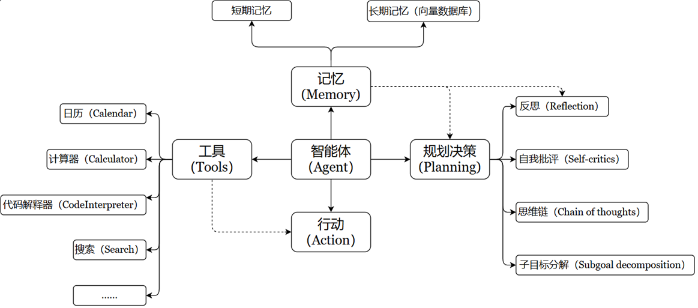
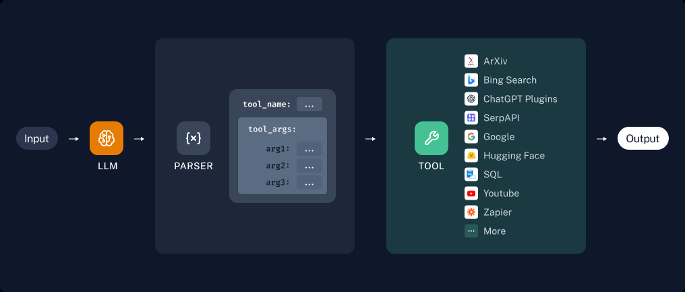

# 第05章：LangChain使用之Tools

讲师：尚硅谷-宋红康

官网：尚硅谷

## 1、Tools概述

### 1.1 介绍

要构建更强大的AI工程应用，只有生成文本这样的“**纸上谈兵**”能力自然是不够的。工具Tools不仅仅是“肢体”的延伸，更是为“大脑”插上了想象力的“翅膀”。借助工具，才能让AI应用的能力真正具备无限的可能，才能从“**认识世界**”走向“**改变世界**”。


Tools 用于扩展大语言模型（LLM）的能力，使其能够与外部系统、API 或自定义函数交互，从而完成仅靠文本生成无法实现的任务（如搜索、计算、数据库查询等）。



**特点：**

- **增强 LLM 的功能**：让 LLM 突破纯文本生成的限制，执行实际操作（如调用搜索引擎、查询数据库、运行代码等）

- **支持智能决策**：在Agent 工作流中，LLM 根据用户输入动态选择最合适的 Tool 完成任务。

- **模块化设计**：每个 Tool 专注一个功能，便于复用和组合（例如：搜索工具 + 计算工具 + 天气查询工具）

LangChain 拥有大量第三方工具。请访问工具集成查看可用工具列表。

https://python.langchain.com/v0.2/docs/integrations/tools/

### 1.2 Tool 的要素

Tools 本质上是封装了特定功能的可调用模块，是Agent、Chain或LLM可以用来与世界互动的接口。

**Tool 通常包含如下几个要素：**

- **name**：工具的名称

- **description**：工具的功能描述

- 该工具输入的**JSON模式**

- 要调用的函数

- **return_direct**：是否应将工具结果直接返回给用户（仅对Agent相关）

**实操步骤：**

- 步骤1：将name、description 和 JSON模式作为上下文提供给LLM

- 步骤2：LLM会根据提示词推断出**需要调用哪些工具**，并提供具体的调用参数信息

- 步骤3：用户需要根据返回的工具调用信息，自行触发相关工具的回调

> 注意：
>
> 如果工具具有**精心选择**的名称、描述和JSON模式，则模型的性能将更好。
>
> 下一章内容我们可以看到工具的调用动作可以通过Agent自主接管。



## 2、自定义工具

### 2.1 两种自定义方式

**第1种：**使用@tool装饰器（自定义工具的最简单方式）

装饰器默认使用函数名称作为工具名称，但可以通过参数**name_or_callable** 来覆盖此设置。

同时，装饰器将使用函数的**文档字符串**作为**工具的描述**，因此函数必须提供文档字符串。

**第2种：**使用StructuredTool.from_function类方法

这类似于**@tool** 装饰器，但允许更多配置和同步/异步实现的规范。

### 2.2 几个常用属性

Tool由几个常用属性组成：

| 属性 | 类型 | 描述 |
| --- | --- | --- |
| name | str | 必选的，在提供给LLM或Agent的工具集中必须是唯一的。 |
| description | str | 可选但建议，描述工具的功能。LLM或Agent将使用此描述作为上下文，使用它确定工具的使用 |
| args_schema | Pydantic BaseModel | 可选但建议，可用于提供更多信息（例如，few-shot示例）或验证预期参数。 |
| return_direct | boolean | 仅对Agent相关。当为True时，在调用给定工具后，Agent将停止并将结果直接返回给用户。 |

### 2.3 具体实现

#### 方式1：@tool 装饰器

举例1：

```
from langchain.tools import tool

@tool
def add_number(a:int,b:int)->int:
    """两个整数相加"""
    return a + b

print(f"name = {add_number.name}")
print(f"args = {add_number.args}")
print(f"description = {add_number.description}")
print(f"return_direct = {add_number.return_direct}")

res = add_number.invoke({"a":10,"b":20})
print(res)
```

```
name = add_number
description = 两个整数相加
args = {"a": {"title": "A", "type": "integer"}, "b": {"title": "B", "type": "integer"}}
return_direct = False
30
```

说明：**return_direct参数**的默认值是False。当return_direct=False时，工具执行结果会返回给Agent，让Agent决定下一步操作；而return_direct=True则会中断这个循环，直接结束流程，返回结果给用户。

举例2：通过@tool的参数设置进行重置

```
from langchain.tools import tool

@tool(name_or_callable="add_two_number",description="two number add",return_direct=True)
def add_number(a:int,b:int)->int:
    """两个整数相加"""
    return a + b

print(f"name = {add_number.name}")
print(f"description = {add_number.description}")
print(f"args = {add_number.args}")
print(f"return_direct = {add_number.return_direct}")

res = add_number.invoke({"a":10,"b":20})
print(res)
```

```
name = add_two_number
description = two number add
args = {"a": {"title": "A", "type": "integer"}, "b": {"title": "B", "type": "integer"}}
return_direct = True
30
```

补充：还可以修改参数的说明

```
from langchain.tools import tool
from pydantic import BaseModel, Field

class FieldInfo(BaseModel):
    a :int = Field(description="第1个参数")
    b :int = Field(description="第2个参数")

@tool(name_or_callable="add_two_number",description="two number add",args_schema=FieldInfo,return_direct=True)
def add_number(a:int,b:int)->int:
    """两个整数相加"""
    return a + b

print(f"name = {add_number.name}")
print(f"description = {add_number.description}")
print(f"args = {add_number.args}")
print(f"return_direct = {add_number.return_direct}")

res = add_number.invoke({"a":10,"b":20})
print(res)
```

```
name = add_two_number
description = two number add
args = {"a": {"description": '第1个参数', "title": "A", "type": "integer"}, "b": {"description": '第2个参数',
"title": "B", "type": "integer"}}
return_direct = True
30
```

#### 方式2：StructuredTool的from_function()

**StructuredTool.from_function** 类方法提供了比**@tool** 装饰器更多的可配置性，而无需太多额外的代码。

举例1：

```
from langchain_core.tools import StructuredTool

def search_function(query: str):
    return "LangChain"

search1 = StructuredTool.from_function(
    func=search_function,
    name="Search",
    description="useful for when you need to answer questions about current events"
)

print(f"name = {search1.name}")
print(f"description = {search1.description}")
print(f"args = {search1.args}")

search1.invoke("hello")
```

```
name = Search
description = useful for when you need to answer questions about current events
args = {"query": {"title": "Query", "type": "string"}}
"LangChain"
```

举例2：

```
from langchain_core.tools import StructuredTool
from pydantic import Field,BaseModel

class FieldInfo(BaseModel):
    query: str = Field(description="要检索的关键词")

def search_function(query: str):
    return "LangChain"

search1 = StructuredTool.from_function(
    func=search_function,
    name="Search",
    description="useful for when you need to answer questions about current events",
    args_schema=FieldInfo,
    return_direct=True,
)

print(f"name = {search1.name}")
print(f"description = {search1.description}")
print(f"args = {search1.args}")
print(f"return_direct = {search1.return_direct}")

search1.invoke("hello")
```

```
name = Search
description = useful for when you need to answer questions about current events
args = {"query": {"description": '要检索的关键词', "title": "Query", "type": "string"}}
return_direct = True
"LangChain"
```

### 2.4 工具调用举例

我们通过大模型分析用户需求，判断是否需要调用指定工具。

#### 举例1：大模型分析调用工具

```
#1.导入相关依赖
from langchain_community.tools import MoveFileTool
from langchain_core.messages import HumanMessage
from langchain_core.utils.function_calling import convert_to_openai_function
import os
import dotenv
from langchain_openai import ChatOpenAI

dotenv.load_dotenv()

os.environ['OPENAI_API_KEY'] = os.getenv("OPENAI_API_KEY1")
os.environ['OPENAI_BASE_URL'] = os.getenv("OPENAI_BASE_URL")

# 2.定义LLM模型
chat_model =ChatOpenAI(model="gpt-4o-mini",temperature=0)

# 3.定义工具
tools = [MoveFileTool()]

# 4.这里需要将工具转换为openai函数，后续再将函数传入模型调用
functions = [convert_to_openai_function(t) for t in tools]

# print(functions[0])

# 5. 提供大模型调用的消息列表
messages = [HumanMessage(content="将文件a移动到桌面")]

# 6.模型使用函数
response = chat_model.invoke(
    input = messages,
    functions=functions
)

print(response)
```

```
content="" additional_kwargs={'function_call': {'arguments':
'{"source_path":"a","destination_path":"/Users/YourUsername/Desktop/a"}', 'name':
'move_file'}, 'refusal': None} response_metadata={"token_usage": {"completion_tokens": 27,
"prompt_tokens": 76, "total_tokens": 103, "completion_tokens_details":
{"accepted_prediction_tokens": 0, "audio_tokens": 0, "reasoning_tokens": 0,
"rejected_prediction_tokens": 0}, "prompt_tokens_details": {"audio_tokens": 0,
"cached_tokens": 0}}, "model_name": "gpt-4o-mini-2024-07-18", "system_fingerprint":
"fp_efad92c60b", "id": "chatcmpl-CBtFfgfF6JSIcHpZwpCrAm7xfPcZf", "service_tier": None,
"finish_reason": "function_call", "logprobs": None} id="run--767ea1fe-3ae8-4d38-a4d0-
e6e2e697d295-0" usage_metadata={"input_tokens": 76, "output_tokens": 27, "total_tokens":
103, "input_token_details": {"audio": 0, "cache_read": 0}, "output_token_details": {"audio": 0,
"reasoning": 0}}
```

模型绑定工具，调用模型，传入Message对象。

作为对照，修改代码：

```
response = chat_model.invoke(
    [HumanMessage(content="今天的天气怎么样？")],
    functions=functions
)

print(response)
```

```
content="抱歉，我无法提供实时天气信息。你可以通过天气预报网站或应用程序查看今天的天气
情况。' additional_kwargs={'refusal': None} response_metadata={"token_usage":
{"completion_tokens": 27, "prompt_tokens": 74, "total_tokens": 101,
"completion_tokens_details": {"accepted_prediction_tokens": 0, "audio_tokens": 0,
"reasoning_tokens": 0, "rejected_prediction_tokens": 0}, "prompt_tokens_details":
{"audio_tokens": 0, "cached_tokens": 0}}, "model_name": "gpt-4o-mini-2024-07-18",
"system_fingerprint": "fp_efad92c60b", "id": "chatcmpl-CBtuCLFV3MpclylCUY2nvyvv4ySLx",
```

```
"service_tier": None, "finish_reason": "stop", "logprobs": None} id="run--00930aff-a6c3-45a6-
8925-a85c135baedb-0" usage_metadata={"input_tokens": 74, "output_tokens": 27,
"total_tokens": 101, "input_token_details": {"audio": 0, "cache_read": 0},
"output_token_details": {"audio": 0, "reasoning": 0}}
```

#### 调用工具说明

**两种情况：**

**情况1：大模型决定调用工具**

如果模型认为需要调用工具（如 **MoveFileTool**），返回的 **message** 会包含：

- **content** : 通常为空（因为模型选择调用工具，而非生成自然语言回复）。

- **additional_kwargs** : 包含工具调用的详细信息：

```
AIMessage(
    content='',  # 无自然语言回复
    additional_kwargs={
        'function_call': {
            'name': 'move_file',  # 工具名称
            'arguments':'{"source_path":"a","destination_path":"/Users/YourUsername/Desktop/a"}'  # 工具参数
        }
    }
)
```

**情况2：大模型不调用工具**

如果模型认为无需调用工具（例如用户输入与工具无关），返回的 **message** 会是普通文本回复：

```
AIMessage(
    content='我没有找到需要移动的文件。',  # 自然语言回复
    additional_kwargs={'refusal': None}  # 无工具调用
)
```

#### 举例2：确定工具并调用

```
# 定义LLM模型
chat_model =ChatOpenAI(model="gpt-4o-mini",temperature=0)

# 定义工具
tools = [MoveFileTool()]

# 将工具转换为openai函数
functions = [convert_to_openai_function(t) for t in tools]

# 提供消息列表
messages = [HumanMessage(content="将本目录下的abc.txt文件移动到C:\\Users\\shkst\\Desktop")]

# 模型调用
response = chat_model.invoke(
    input=messages,
    functions=functions
)

print(response)
```

```
content="" additional_kwargs={"function_call": {"arguments":
"{'source_path':'abc.txt','destination_path':'C:\\Users\\shkst\\Desktop\\abc.txt'}", "name":
"move_file"}, "refusal": None} response_metadata={"token_usage": {"completion_tokens": 32,
"prompt_tokens": 86, "total_tokens": 118, "completion_tokens_details":
{"accepted_prediction_tokens": 0, "audio_tokens": 0, "reasoning_tokens": 0,
"rejected_prediction_tokens": 0}, "prompt_tokens_details": {"audio_tokens": 0,
"cached_tokens": 0}}, "model_name": "gpt-4o-mini-2024-07-18", "system_fingerprint":
"fp_efad92c60b", "id": "chatcmpl-C0VovYCSwz4rPSd6vFlOZ4iGdM6P3", "service_tier": None,
"finish_reason": "function_call", "logprobs": None} id="run--f8191da7-6093-4ea0-ae28-
17e703676392-0" usage_metadata={"input_tokens": 86, "output_tokens": 32, "total_tokens":
118, "input_token_details": {"audio": 0, "cache_read": 0}, "output_token_details": {"audio": 0,
"reasoning": 0}}
```

**(1) 检查是否需要调用工具**

```
import json

if "function_call" in response.additional_kwargs:
    tool_name = response.additional_kwargs["function_call"]["name"]
    tool_args = json.loads(message.additional_kwargs["function_call"]["arguments"])
    print(f"调用工具: {tool_name}, 参数: {tool_args}")
else:
    print("模型回复:", response.content)
```

```
调用工具: move_file, 参数: {"source_path": "abc.txt", "destination_path":
"C:\Users\shkst\Desktop\abc.txt"}
```

**(2) 实际执行工具调用**

```
from langchain.tools import MoveFileTool

if "move_file" in response.additional_kwargs["function_call"]["name"]:
    tool = MoveFileTool()
    result = tool.run(tool_args)  # 执行工具
    print("工具执行结果:", result)
```

> 工具执行结果: File moved successfully from abc.txt to C:\Users\shkst\Desktop\abc.txt.
